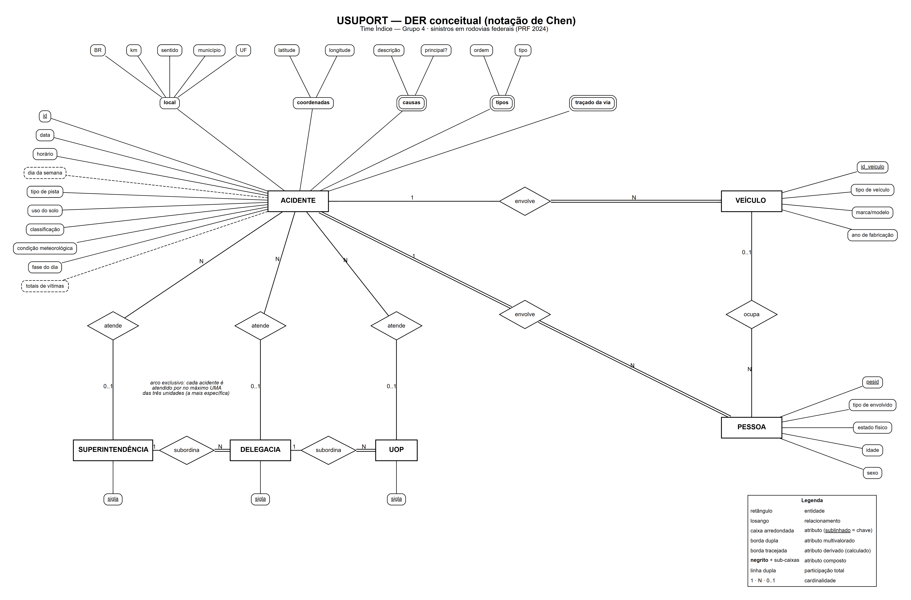
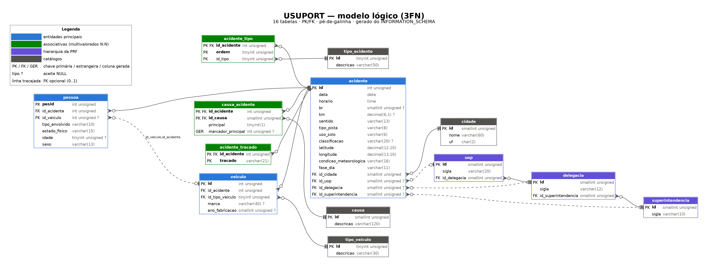

# Time Índice — Grupo 4 — Cenário USUPORT

**UNIFACS — Campus CTN, Salvador** · UC Projeto Integrador de Banco de Dados — Avaliação A3
Professores: Sergio Spinola e Alexandre Anunciação

| Integrante | RA |
|---|---|
| Filipe Albuquerque Oliveira | 12725146899 |
| Guilherme Cabral Teixeira | 12725188306 |
| Arthur Cordeiro de Carvalho Cruz | 12725113247 |
| Miguel Lima Quadros Gomes | 1272514349 |
| Alisson Sousa Santos | 12725158318 |
| Cláudio Roberto Cruz Santiago Santos | 12725151039 |

**Sistema de gestão e análise de sinistros em rodovias federais.** A planilha da PRF de 2024 (603.215 linhas redundantes) vira um banco MySQL 8 normalizado até a 3FN, com **13 tabelas** e **5 views**. O banco roda numa VM do VirtualBox, é inspecionado pelo DBeaver e é manipulado por um app CRUD em Python + Streamlit com SQL puro e parametrizado.

## O problema

A Polícia Rodoviária Federal (PRF) publica os sinistros das rodovias federais numa planilha. A de 2024 é a base entregue à equipe no cenário **USUPORT**. Ela tem **603.215 linhas para só 73.156 acidentes**, porque cada linha repete o acidente inteiro para cada combinação de pessoa, causa e tipo de evento. O acidente do ônibus em Teófilo Otoni (MG), em 21/12/2024, com 53 pessoas e 37 mortes, ocupa sozinho **1.540 linhas**.

Com os dados assim, perguntas simples, como "quais causas mais matam?" ou "em quais trechos?", exigem limpar e deduplicar a planilha toda vez. Uma correção também precisa ser repetida em centenas de linhas, e o mesmo acidente pode acabar com dois valores diferentes. São dados de segurança viária, com **6.160 mortes registradas em 2024**, usados para orientar fiscalização, campanhas e a gestão das unidades da PRF.

## Como o banco resolve

- **Dados:** a planilha é carregada uma vez e transformada num banco relacional normalizado até a 3FN. Cada fato (acidente, pessoa, veículo, causa, tipo, traçado) é gravado **uma única vez**, e a planilha original pode ser remontada por consulta quando for preciso.
- **Regras:** as regras de negócio foram tiradas dos próprios dados e são garantidas pelo SGBD, com chaves, CHECK e UNIQUE. Exemplos: todo acidente tem exatamente uma causa principal; condutor e passageiro sempre estão num veículo, e pedestre e testemunha nunca; uma pessoa só ocupa veículo do mesmo acidente.
- **Uso:** consultas SQL respondem às perguntas da gestão (causas mais letais, trechos críticos, horários, perfil das vítimas). Um app permite consultar, cadastrar e excluir acidentes e ver um painel gerencial, com persistência direta no banco.

## Modelo de dados (DER)

**DER conceitual** (notação de Chen): entidades, atributos (chave, compostos, multivalorados e derivados), relacionamentos e cardinalidades.



**Modelo lógico** (tabelas, chaves primárias e estrangeiras), gerado a partir do próprio banco carregado:



O dicionário de dados completo (campos, tipos, restrições e finalidade de cada tabela) está no relatório técnico, entregue em PDF aos professores. No próprio banco, cada tabela e cada coluna tem um `COMMENT` com a sua finalidade: veja o `sql/01_ddl.sql` ou a aba *Colunas* do DBeaver.

## Tecnologias e por que foram escolhidas

| Ferramenta | Uso no projeto | Por quê |
|---|---|---|
| **MySQL 8** | SGBD | é um dos SGBDs indicados no edital. A partir da 8.0.16 ele aplica CHECK de fato, e tem CTE, funções de janela e JSON_TABLE, usados na carga e nas consultas |
| **Oracle VirtualBox + Ubuntu Server** | máquina virtual onde o MySQL roda | exigência do edital. O Ubuntu instala o MySQL 8 direto do repositório oficial (`apt`) |
| **DBeaver** (ou MySQL Workbench) | inspeção do esquema físico pela rede | gratuito; mostra tabelas, restrições, índices e o diagrama gerado pelo próprio banco |
| **Python + Streamlit** | app CRUD e painel gerencial | sugeridos no edital. A interface web sai com pouco código, e o foco fica no SQL |
| **mysql-connector-python**, sem ORM | acesso ao banco | todo o SQL fica escrito à mão, explícito e parametrizado, como o edital pede |
| **Docker** (só para testar) | MySQL descartável | recriar o banco do zero a cada mudança antes de levar para a VM |

## Normalização (resumo)

- **1FN:** o traçado da via vinha com vários valores numa célula ("Reta;Declive") e virou uma linha por valor. km e coordenadas, que vinham como texto, viraram número.
- **2FN:** a chave da planilha era (acidente, pessoa, veículo, causa, ordem do tipo, traçado), e cada grupo de atributos dependia só de **parte** dela. Daí surgem as tabelas de acidente, pessoa e veículo e as tabelas associativas de causas, tipos e traçados. O acidente do ônibus cai de 1.540 linhas para 74.
- **3FN:** a cadeia UOP → delegacia → superintendência virou uma hierarquia de tabelas. O dia da semana e os totais de vítimas são derivados e deixaram de ser guardados: são calculados por consulta.
- **Decisões conscientes:**
  - o acidente aponta para a unidade da PRF mais específica que se conhece (um "arco" exclusivo);
  - a pessoa guarda o acidente e o veículo, com uma FK composta que impede divergência;
  - a classificação do acidente é mantida e conferida contra o estado físico das pessoas.

  O passo a passo completo está no relatório técnico, seção 5.

## Testes e validação

- **Carga:** o `sql/04_validacao.sql` compara o **esperado**, medido no CSV por um perfilamento independente em Python, com o **obtido** no banco: a contagem de cada tabela, quantos registros cada regra de limpeza afetou e cada regra de negócio. Resultado: **0 divergências**.
- **Integridade:** o `sql/05_dml_exemplos.sql` traz massa de teste fictícia (acidentes completos), UPDATEs e uma exclusão controlada em transação. Traz também comandos que **devem falhar**, cada um mostrando uma restrição do banco recusando um dado inválido: CHECK (erro 3819), FK (1452), UNIQUE (1062) e RESTRICT (1451).
- **Consultas:** todas as consultas do `sql/06_dql_consultas.sql` foram executadas sobre a base completa. O painel do app roda exatamente o mesmo arquivo.
- **App:** inserção, consulta e exclusão foram testadas na interface, e a persistência foi conferida direto no banco.
- **Reprodução:** o `sql/00_completo.sql` recria e valida o banco inteiro do zero.

## Estrutura

```
├── README.md                    ← este arquivo
├── requirements.txt             ← dependências do app (streamlit, mysql-connector-python, pandas, altair)
├── .env.example                 ← modelo de configuração da conexão (copie para .env)
├── sql/
│   ├── 00_completo.sql          ← pacote ÚNICO (01..07 concatenados)
│   ├── 01_ddl.sql               ← CREATE DATABASE, DROP/CREATE das 13 tabelas, PK/FK/UNIQUE/CHECK, índices, ALTER TABLE
│   ├── 02_staging.sql           ← staging + LOAD DATA LOCAL INFILE (latin1)
│   ├── 03_carga.sql             ← INSERT…SELECT da staging para as 13 tabelas + regras de limpeza R0–R12
│   ├── 04_validacao.sql         ← esperado × obtido (contagens, limpeza, regras de negócio) — 0 divergências
│   ├── 05_dml_exemplos.sql      ← INSERT fictício completo, UPDATEs, DELETE controlado em transação
│   ├── 06_dql_consultas.sql     ← 18 consultas gerenciais (JOINs, GROUP BY, COUNT, AVG, filtro temporal)
│   └── 07_views.sql             ← vw_acidente_detalhe, vw_acidente_totais, vw_pessoa_detalhe…
├── app/                         ← aplicação Streamlit (CRUD + painel)
│   ├── app.py                   ← entrada e navegação
│   ├── db.py                    ← TODO o SQL da aplicação (camada de acesso ao banco)
│   ├── componentes.py           ← expander "SQL executado", mensagens de erro
│   └── paginas/                 ← consulta.py · insercao.py · exclusao.py · painel.py
├── docs/
│   ├── der_conceitual.png       ← DER conceitual (Chen) em alta resolução
│   └── der_logico.png           ← modelo lógico (tabelas, PK/FK)
└── dados/                       ← CSV da PRF compactado (.csv.gz) + README
```

## Como reproduzir do zero

### 1. Banco de dados (na VM Ubuntu com MySQL 8)

Resumo da VM (o passo a passo completo está na seção 8 do relatório técnico):

1. **VirtualBox** (gratuito) com **Ubuntu Server**. Rede em *Placa em modo Bridge*, ou NAT com redirecionamento da porta 3306.
2. MySQL 8 e acesso pela rede:

   ```bash
   sudo apt update && sudo apt install -y mysql-server
   # em /etc/mysql/mysql.conf.d/mysqld.cnf:  bind-address = 0.0.0.0   e   local_infile = 1
   sudo systemctl restart mysql
   ```

3. Usuários (troque as senhas):

   ```sql
   CREATE USER 'usuport_admin'@'%' IDENTIFIED BY '<senha_admin>';
   GRANT ALL PRIVILEGES ON usuport.* TO 'usuport_admin'@'%';
   CREATE USER 'usuport_app'@'%' IDENTIFIED BY '<senha_app>';
   GRANT SELECT, INSERT, UPDATE, DELETE, EXECUTE ON usuport.* TO 'usuport_app'@'%';
   ```

   O `usuport_admin` é usado no DBeaver; o `usuport_app`, na aplicação, só com DML e EXECUTE, sem DDL (menor privilégio).

O CSV da PRF está no repositório compactado: `dados/acidentes2024_todas_causas_tipos_Usuport.csv.gz`, com 13 MB (o original tem 222 MB e passa do limite de 100 MB do GitHub). Descompacte e carregue **a partir da raiz do projeto**:

```bash
gunzip -k dados/acidentes2024_todas_causas_tipos_Usuport.csv.gz
```


```bash
sudo mysql --local-infile=1 --default-character-set=utf8mb4 < sql/00_completo.sql
```

Em cerca de 1 a 2 minutos o banco `usuport` está criado, carregado e validado, com todas as linhas da validação `OK`; no ambiente de teste levou uns 40 s. Para executar por etapas, rode os scripts de `sql/` na ordem numérica.

### 2. Aplicação (no computador)

```bash
pip install -r requirements.txt
```

Copie o modelo de configuração: no Windows, `copy .env.example .env`; no Linux, `cp .env.example .env`.

Edite o `.env` com o IP/porta da VM e a senha do `usuport_app`. Depois:

```bash
streamlit run app/app.py
```

O app abre em `http://localhost:8501`. A barra lateral mostra a versão do MySQL e o hostname do servidor conectado.

## Resultados da carga (validados)

| Tabela | Linhas | Tabela | Linhas |
|---|---|---|---|
| acidente | 73.156 | causa_acidente | 111.307 |
| pessoa | 179.114 | acidente_tipo | 124.173 |
| veiculo | 139.617 | acidente_tracado | 93.850 |
| cidade | 1.873 | causa / tipo_acidente / tipo_veiculo (catálogos) | 70 / 17 / 25 |
| superintendencia / delegacia / uop | 28 / 152 / 394 | condição meteorológica / fase do dia / traçado (CHECK, sem tabela) | 10 / 4 / 12 valores |

A validação tem 59 verificações (contagens, regras de limpeza e regras de negócio) e terminou com **0 divergências**. Tudo foi testado num MySQL 8.0.46 em Docker antes de ir para a VM.
