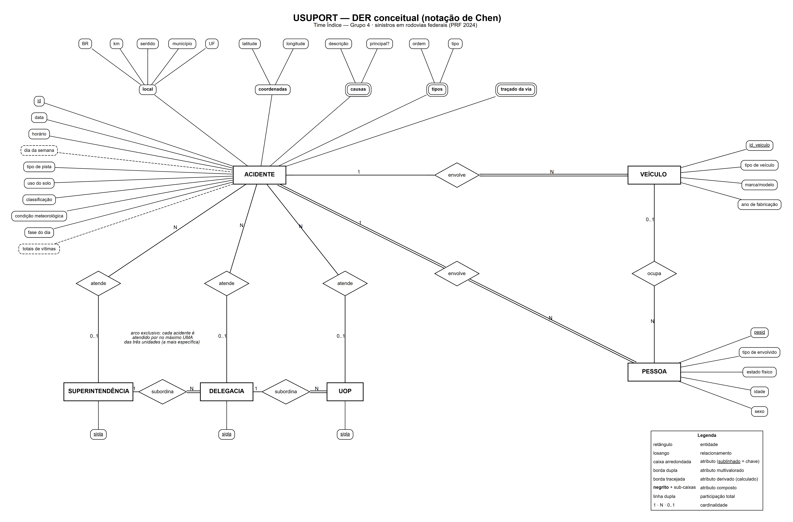
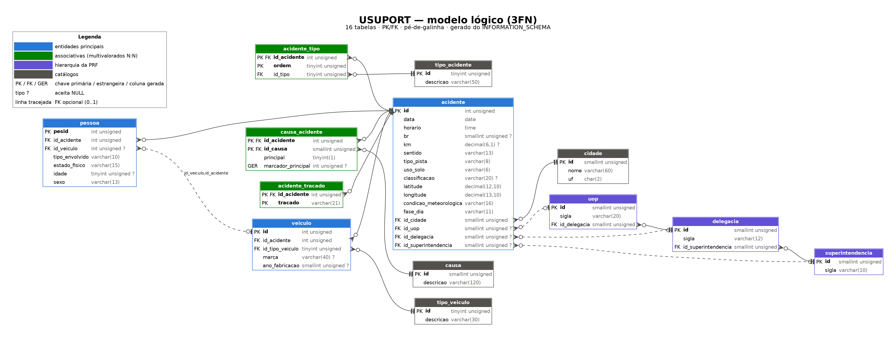
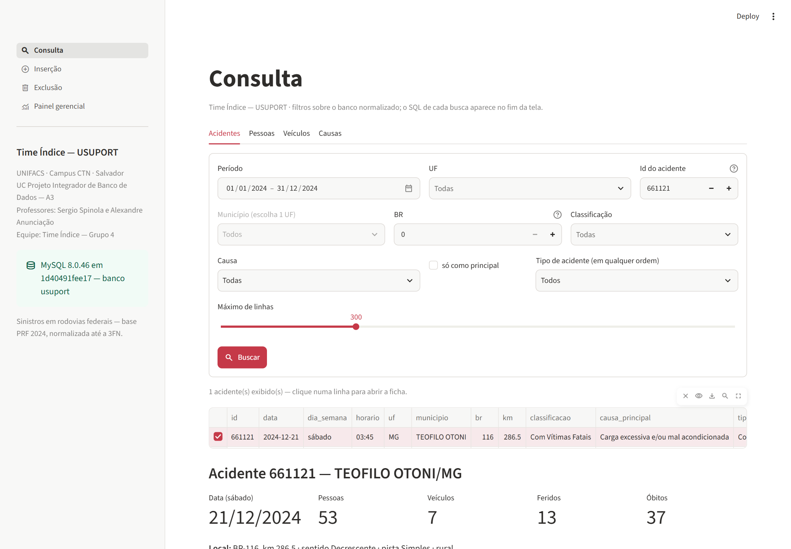
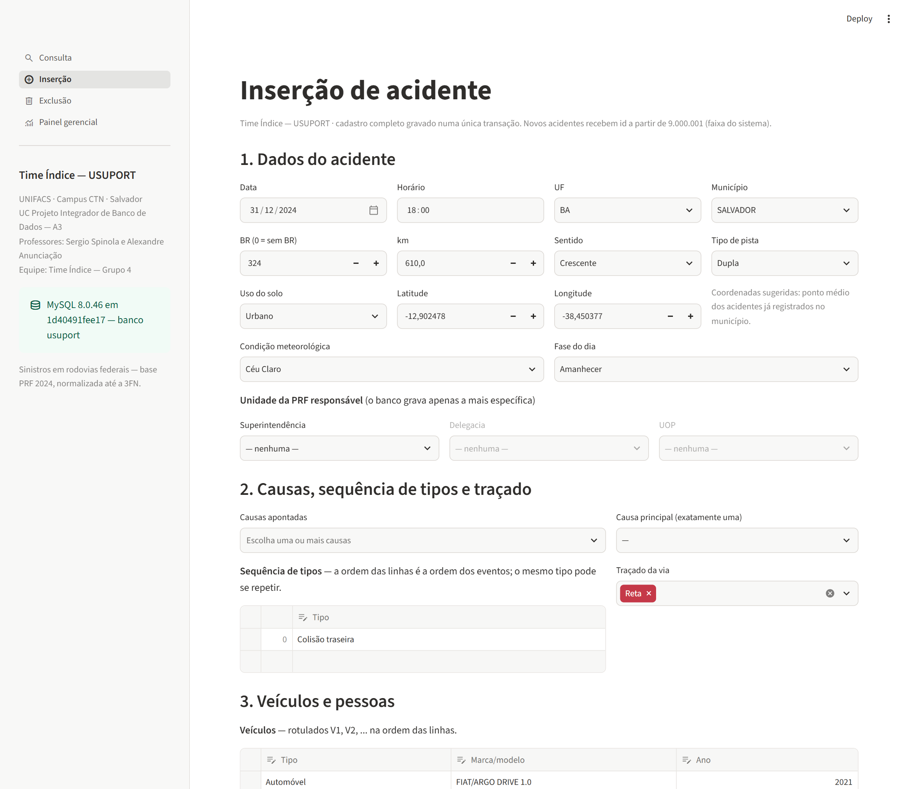
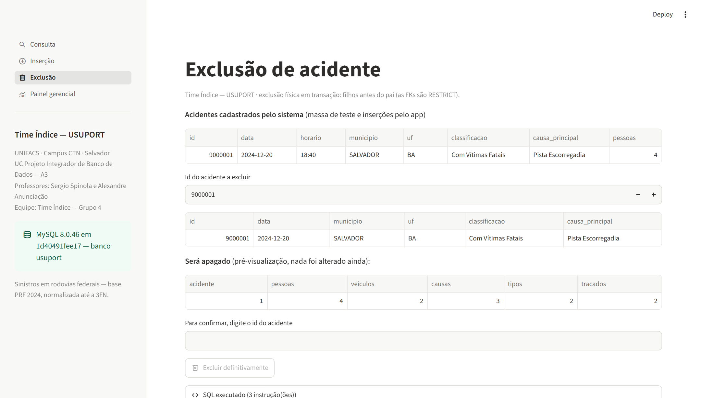
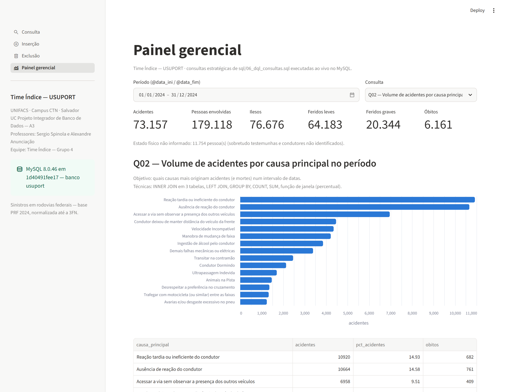

<div class="capa" markdown="1">

<p class="instituicao">UNIFACS — Universidade Salvador · Campus CTN, Salvador</p>
<p class="uc">UC Projeto Integrador de Banco de Dados — Avaliação A3<br/>Trilha Oracle Academy: Database Design &amp; Programming with SQL</p>

<p class="titulo">USUPORT</p>
<p class="subtitulo">Sistema de gestão e análise de sinistros em rodovias federais<br/>Relatório técnico — modelagem, implementação e aplicação</p>

<p class="equipe"><strong>Equipe: Time Índice — Grupo 4</strong> &nbsp;|&nbsp; <strong>Cenário: USUPORT</strong></p>

| Integrante | RA |
|---|---|
| Filipe Albuquerque Oliveira | 12725146899 |
| Guilherme Cabral Teixeira | 12725188306 |
| Arthur Cordeiro de Carvalho Cruz | 12725113247 |
| Miguel Lima Quadros Gomes | 1272514349 |
| Alisson Sousa Santos | 12725158318 |
| Cláudio Roberto Cruz Santiago Santos | 12725151039 |

<p class="professores">Professores: Sergio Spinola e Alexandre Anunciação</p>
<p class="local">Salvador — novembro de 2026</p>

</div>

<div class="sumario" markdown="1">

<p class="titulo-sumario">Sumário</p>

[TOC]

</div>

# 1. Contextualização e justificativa do cenário

## 1.1 O cenário USUPORT

O edital propõe que cada equipe atue como **Arquitetos de Dados e Desenvolvedores de Software**, cobrindo o ciclo de vida completo do dado: da modelagem teórica à implementação física em ambiente virtualizado, com uma interface para manipular os registros. O professor atribuiu ao Grupo 4 o cenário **USUPORT** (significado da sigla: **[significado de USUPORT — confirmar com o professor]**). A base de dados desse cenário é a planilha de **sinistros nas rodovias federais registrados pela Polícia Rodoviária Federal (PRF) em 2024**, que deve ser transformada num banco relacional normalizado até a 3ª Forma Normal.

## 1.2 Contexto de aplicabilidade delimitado pelo grupo

**Sistema de gestão e análise de sinistros em rodovias federais.** Analistas de segurança viária e gestores das unidades da PRF precisam responder perguntas como:

- quais causas mais matam;
- em que trechos e horários se concentram os acidentes;
- qual unidade atende mais ocorrências.

Também é preciso cadastrar, corrigir e excluir registros com segurança. Hoje a informação está numa planilha que não suporta nada disso de forma confiável.

## 1.3 Justificativa: o problema da planilha

| Indicador | Valor |
|---|---|
| Linhas da planilha | **603.215** |
| Acidentes distintos | **73.156**, ou seja, cada acidente repetido em média 8,2 vezes |
| Pior caso | acidente 661121 (ônibus, Teófilo Otoni/MG): **1.540 linhas** para 53 pessoas, 7 veículos, 4 causas e 7 tipos |
| Colunas derivadas armazenadas | `dia_semana`, `ilesos`, `feridos_leves`, `feridos_graves`, `mortos` |
| Célula com vários valores | `tracado_via` (ex.: "Aclive;Curva"; até 8 valores) |
| Dados sujos | id em notação científica, "NA" como texto, idades de até 2023 anos, ano de fabricação 0… |

Cada linha combina **acidente × pessoa × causa × tipo**. Corrigir o km de um acidente exige alterar centenas de linhas (anomalia de atualização). Não é possível cadastrar uma UOP ou uma causa sem um acidente (anomalia de inserção). Apagar o último acidente de uma UOP apaga a informação de a qual delegacia ela pertence (anomalia de exclusão). O banco normalizado elimina essas anomalias, garante as regras de negócio por restrições declarativas e torna as consultas gerenciais rápidas e confiáveis.

## 1.4 Visão geral da solução

```
 CSV PRF 2024 (Latin-1, 603 mil linhas)
      │  LOAD DATA LOCAL INFILE  (ou scripts/carregar_staging.py)
      ▼
 staging (texto bruto) ──INSERT…SELECT + limpeza R0–R11──►  16 tabelas em 3FN  ──►  5 views
                                                              │
        VirtualBox / Ubuntu / MySQL 8  ◄──── rede :3306 ────► DBeaver (inspeção)
                                                              │
                                              App Streamlit (Python + mysql-connector, SQL puro)
                                              Consulta · Inserção · Exclusão · Painel gerencial
```

# 2. Levantamento de requisitos e regras de negócio

<!-- incluir: requisitos_regras.md -->

# 3. Modelagem conceitual — DER

O DER conceitual, em notação de Chen, representa o **negócio**, e não as tabelas. Nele aparecem:

- **Entidades:** ACIDENTE, PESSOA, VEÍCULO, UOP, DELEGACIA e SUPERINTENDÊNCIA.
- **Relacionamentos:**
  - *envolve*: acidente 1:N pessoa e acidente 1:N veículo;
  - *ocupa*: veículo 0..1:N pessoa;
  - *atende*: unidade da PRF 0..1:N acidente, em **arco exclusivo**;
  - *subordina*: delegacia 1:N UOP e superintendência 1:N delegacia.
- **Atributos** (caixas arredondadas; os atributos-chave aparecem sublinhados): id, pesid, id_veiculo e sigla.
- **Atributos multivalorados** (caixa de borda dupla): **causas** (com o indicador *principal?*), **tipos** (sequência com *ordem*) e **traçado da via**.
- **Atributos compostos:** **local** (BR, km, sentido, município, UF) e **coordenadas** (latitude, longitude).
- **Atributos derivados** (tracejados, não armazenados): **dia da semana** e **totais de vítimas**.
- **Cardinalidades:** junto a cada linha, com o mínimo e o máximo observados no CSV. A linha dupla indica participação total.

<div class="figura paisagem" markdown="1">



<p class="legenda">Figura 1 — DER conceitual (fonte editável: <code>docs/der_conceitual.dot</code>; PNG em alta resolução: <code>docs/der_conceitual.png</code>).</p>

</div>

# 4. Modelo lógico relacional

## 4.1 Do conceitual ao lógico

| Elemento do DER | Tradução no modelo lógico |
|---|---|
| Entidade ACIDENTE / PESSOA / VEÍCULO | tabelas `acidente`, `pessoa`, `veiculo`, com os ids da PRF como PK |
| Atributo multivalorado *causas* (com *principal?*) | tabela `causa_acidente`(id_acidente, id_causa, principal) + catálogo `causa` |
| Atributo multivalorado *tipos* (com *ordem*) | tabela `acidente_tipo`(id_acidente, **ordem**, id_tipo) + catálogo `tipo_acidente` |
| Atributo multivalorado *traçado* | tabela `acidente_tracado`(id_acidente, id_tracado) + catálogo `tracado` |
| Atributo composto *local* | colunas `br`, `km`, `sentido` + FK `id_cidade` → `cidade`(nome, uf) |
| Atributo composto *coordenadas* | colunas `latitude`, `longitude` (DECIMAL) |
| Atributos derivados | não armazenados: views `vw_acidente_detalhe` (dia da semana) e `vw_acidente_totais` (vítimas) |
| Relacionamento 1:N *envolve* | FK `id_acidente` em `pessoa` e em `veiculo` (sempre no lado N) |
| Relacionamento 0..1:N *ocupa* | FK opcional `id_veiculo` em `pessoa`, composta com `id_acidente` |
| Hierarquia *subordina* | `uop.id_delegacia` → `delegacia.id_superintendencia` → `superintendencia` |
| Arco *atende* | `acidente.id_uop` / `id_delegacia` / `id_superintendencia` + CHECK "no máximo uma" |
| Atributos simples de lista grande | catálogos `condicao_meteorologica`, `fase_dia`, `tipo_veiculo` |
| Atributos simples de lista pequena e fixa | colunas com CHECK: sentido, tipo_pista, uso_solo, classificação, sexo, estado_fisico, tipo_envolvido |

<div class="figura paisagem" markdown="1">



<p class="legenda">Figura 2 — Modelo lógico em 3FN, gerado do INFORMATION_SCHEMA do banco carregado (<code>scripts/gerar_diagramas.py</code>). O diagrama físico também pode ser exportado pelo DBeaver: botão direito no banco → <em>Visualizar diagrama</em> → <em>Exportar diagrama</em>.</p>

</div>

## 4.2 Critério do grupo: tabela de catálogo × coluna com CHECK

Uma lista de valores vira **tabela nova** em dois casos:

- **(a)** quando **traz informação junto**, como cidade → UF e UOP → delegacia → superintendência. Aqui a separação decorre da normalização;
- **(b)** quando a lista é **grande ou pode mudar**: causa (70), tipo de acidente (17), traçado (12), tipo de veículo (25), condição meteorológica (10) e fase do dia (4). Aqui é uma escolha de padronização.

Listas **pequenas e fixas** viram coluna com **CHECK**: sexo (4), sentido (3), tipo de pista (3), uso do solo (2), estado físico (5), tipo de envolvido (5) e classificação (3). Os domínios foram levantados do próprio CSV antes de escrever os CHECKs.

# 5. Memorial de normalização

<!-- incluir: memorial_normalizacao.md -->

# 6. Dicionário de dados

<!-- incluir: dicionario_dados.md -->

# 7. Implementação do banco de dados (SQL)

## 7.1 Pacote de scripts

| Script | Linguagem | Conteúdo |
|---|---|---|
| `sql/01_ddl.sql` | DDL | `CREATE DATABASE`; `DROP TABLE IF EXISTS` na ordem inversa das FKs; `CREATE TABLE` das 16 tabelas com PK, FK, UNIQUE, NOT NULL, CHECK, índices e `COMMENT`; 3 `ALTER TABLE` comentados |
| `sql/02_staging.sql` | DDL + carga | tabela de staging (texto) + `LOAD DATA LOCAL INFILE … CHARACTER SET latin1` |
| `sql/03_carga.sql` | DML | `INSERT … SELECT DISTINCT` da staging para cada tabela, na ordem das FKs; traçado quebrado com `JSON_TABLE` (alternativa com CTE recursiva comentada); regras R0–R11; reserva de ids ≥ 9.000.001 |
| `sql/04_validacao.sql` | DQL | 57 verificações esperado × obtido; remove a staging |
| `sql/05_dml_exemplos.sql` | DML | 2 acidentes fictícios completos (INSERT em transação), 4 UPDATEs, ROLLBACK, DELETE controlado (expurgo) e 6 comandos que devem falhar |
| `sql/06_dql_consultas.sql` | DQL | 18 consultas gerenciais |
| `sql/07_views.sql` | DDL | 5 views |
| `sql/00_completo.sql` | — | todos os anteriores concatenados (pacote único) |

## 7.2 Destaques do DDL

**Arco exclusivo da unidade da PRF:**

```sql
CONSTRAINT ck_acidente_unidade_unica CHECK (
      (id_uop IS NOT NULL) + (id_delegacia IS NOT NULL) + (id_superintendencia IS NOT NULL) <= 1)
```

**Pessoa só em veículo do mesmo acidente** (FK composta) e **papel × veículo** (CHECK):

```sql
CONSTRAINT ck_pessoa_envolvido_veiculo CHECK (
      (tipo_envolvido IN ('Condutor','Passageiro')) = (id_veiculo IS NOT NULL)),
...
ALTER TABLE pessoa
    ADD CONSTRAINT fk_pessoa_veiculo_mesmo_acidente
        FOREIGN KEY (id_veiculo, id_acidente) REFERENCES veiculo (id, id_acidente);
```

**No máximo uma causa principal por acidente.** O CHECK não enxerga outras linhas, então usamos uma coluna gerada + UNIQUE:

```sql
ALTER TABLE causa_acidente
    ADD COLUMN marcador_principal INT UNSIGNED
        GENERATED ALWAYS AS (IF(principal, id_acidente, NULL)) VIRTUAL,
    ADD CONSTRAINT uq_causa_acidente_uma_principal UNIQUE (marcador_principal);
```

## 7.3 Carga e regras de limpeza

<div class="tabela-compacta" markdown="1">

| Regra | Transformação | Registros afetados |
|---|---|---|
| R0 | id "6e+05" (notação científica) → 600000 | 3 linhas |
| R1 | "NA"/"N/A" → NULL | br/km 186 acidentes; classificação 1; idade 17.140 pessoas; uop 112, delegacia 36, regional 3 acidentes |
| R2 | km "272,5" → 272.5 | 27.170 acidentes |
| R3 | latitude/longitude texto → DECIMAL | 73.156 acidentes |
| R4 | uso_solo Sim/Não → Urbano/Rural | 31.451 urbanos / 41.705 rurais |
| R5 | traçado "A;B" → linhas em `acidente_tracado` | 18.458 acidentes multivalorados → 93.850 pares |
| R6 | idade > 110 → NULL | 282 pessoas |
| R7 | ano de fabricação 0 → NULL | 10.122 veículos |
| R8 | marca "Não Informado/Não Informado" → NULL | 8.070 veículos |
| R9 | linha sem pesid → só veículo | 57.641 linhas → 17.192 veículos sem pessoa |
| R10 | unidade ausente → unidade mais específica (arco) | 76 só delegacia, 33 só superintendência, 3 nenhuma |
| R11 | dia_semana e contadores de vítimas não carregados | conferidos: 0 divergências |

</div>

O traçado multivalorado é quebrado assim:

```sql
INSERT INTO acidente_tracado (id_acidente, id_tracado)
SELECT DISTINCT CAST(s.id AS UNSIGNED), t.id
  FROM (SELECT DISTINCT id, tracado_via FROM stg_acidente_csv) s
 CROSS JOIN JSON_TABLE(CONCAT('["', REPLACE(s.tracado_via, ';', '","'), '"]'),
                       '$[*]' COLUMNS (valor VARCHAR(30) COLLATE utf8mb4_0900_ai_ci PATH '$')) AS j
  JOIN tracado t ON t.descricao = TRIM(j.valor);
```

## 7.4 Validação da carga

O `04_validacao.sql` executa **57 verificações**. Todas resultaram **OK (0 divergências)**. Principais:

| Verificação | Esperado | Obtido |
|---|---|---|
| acidentes / pessoas / veículos | 73.156 / 179.114 / 139.617 | 73.156 / 179.114 / 139.617 |
| causas / tipos / traçados / tipos de veículo | 70 / 17 / 12 / 25 | 70 / 17 / 12 / 25 |
| superintendências / delegacias / UOPs | 28 / 152 / 394 | 28 / 152 / 394 |
| acidentes sem exatamente 1 causa principal | 0 | 0 |
| acidentes com tipo repetido em ordens diferentes | 1.509 | 1.509 |
| pessoas em veículo de outro acidente | 0 | 0 |
| classificação divergente do estado físico | 0 | 0 |
| dia_semana do CSV diferente do calculado | 0 | 0 |
| mortos no CSV × pessoas com "Óbito" | 6.160 | 6.160 |
| acidentes atendidos por SPRF de outra UF | 1.289 | 1.289 |

## 7.5 DML de demonstração

O `05_dml_exemplos.sql` cobre três grupos de comandos:

- **INSERT:** dois acidentes fictícios e consistentes, em transação, com FKs resolvidas por subconsulta pela descrição.
- **UPDATE:**
  - correção de idade;
  - óbito + reclassificação **na mesma transação**;
  - troca da causa principal em dois passos (por causa da UNIQUE);
  - padronização do catálogo "Semireboque" → "Semirreboque", em que uma linha alterada reflete em 15.245 veículos.
- **DELETE:** demonstração de `ROLLBACK` e **expurgo controlado** do 2º acidente, filho → pai, com a trava `id >= 9000001`.

O bloco 4 traz seis comandos que **devem falhar**, todos testados com o erro esperado: 3819 (CHECK), 1452 (FK composta), 1062 (UNIQUE da causa principal), 1451 (RESTRICT) e 3819 (arco).

## 7.6 DQL — consultas estratégicas

<div class="tabela-compacta" markdown="1">

| # | Consulta | Técnicas |
|---|---|---|
| Q01 | Acidentes e óbitos por UF e mês | CTE, INNER + LEFT JOIN, GROUP BY, filtro temporal |
| Q02 | Volume de acidentes por causa principal no período | 3 INNER JOIN, LEFT JOIN, COUNT, SUM, janela (%) |
| Q03 | Óbitos por tipo de veículo | 4 INNER JOIN, COUNT, SUM, **AVG** |
| Q04 | Fase do dia × condição meteorológica | GROUP BY em 2 colunas |
| Q05 | Média de idade por estado físico e sexo | **AVG**, MIN, MAX, COUNT(coluna) |
| Q06 | Traçados com mais vítimas fatais | JOIN na associativa N:N |
| Q07 | Ranking das superintendências | cadeia de LEFT JOIN com COALESCE (arco) |
| Q08 | Top 20 UOPs | 4 INNER JOIN, RANK() |
| Q09 | Trechos críticos (BR + 10 km) | expressão no GROUP BY, HAVING |
| Q10 | Urbano × rural | AVG, percentual com janela |
| Q11 | Veículos sem pessoa registrada | **LEFT JOIN … IS NULL** |
| Q12 | Acidentes por dia da semana | DAYNAME + lc_time_names (atributo derivado) |
| Q13 | Letalidade pelo primeiro evento | JOIN com condição extra (ordem = 1) |
| Q14 | Vítimas fatais por faixa etária e papel | CASE |
| Q15 | Acidentes por hora e classificação | HOUR(), SUM condicional |
| Q16 | Ficha completa de um acidente | junção de 10 tabelas, GROUP_CONCAT |
| Q17 | Top 15 municípios | GROUP BY na chave (nome, uf) |
| Q18 | Atendidos por superintendência de outra UF | arco + RIGHT() |

</div>

Exemplo, a Q02 (o "volume por categoria num intervalo de datas" pedido no edital):

```sql
WITH totais AS (
    SELECT id_acidente, SUM(estado_fisico = 'Óbito') AS mortos
      FROM pessoa GROUP BY id_acidente
)
SELECT ca_desc.descricao                                AS causa_principal,
       COUNT(*)                                         AS acidentes,
       ROUND(100 * COUNT(*) / SUM(COUNT(*)) OVER (), 2) AS pct_acidentes,
       COALESCE(SUM(t.mortos), 0)                       AS obitos
  FROM acidente a
 INNER JOIN causa_acidente ca      ON ca.id_acidente = a.id AND ca.principal = TRUE
 INNER JOIN causa          ca_desc ON ca_desc.id = ca.id_causa
  LEFT JOIN totais         t       ON t.id_acidente = a.id
 WHERE a.data BETWEEN @data_ini AND @data_fim
 GROUP BY ca_desc.descricao
 ORDER BY acidentes DESC
 LIMIT 15;
```

## 7.7 Views

| View | Finalidade |
|---|---|
| `vw_acidente_unidade` | resolve o arco: UOP, delegacia e superintendência de cada acidente |
| `vw_acidente_totais` | pessoas, ilesos, feridos e mortos por acidente (atributos derivados) |
| `vw_acidente_detalhe` | ficha do acidente: dia da semana calculado, causas/tipos/traçados com GROUP_CONCAT, totais |
| `vw_pessoa_detalhe` | pessoa + acidente + veículo |
| `vw_classificacao_conferencia` | classificação registrada × calculada (RN08) |

# 8. Infraestrutura e virtualização

O MySQL 8 roda **dentro de uma VM do Oracle VM VirtualBox** com Ubuntu Server. A VM é exposta à rede por **Placa em modo Bridge** (IP próprio) ou por **NAT com redirecionamento da porta 3306**. O servidor é configurado com `bind-address = 0.0.0.0` e `local_infile = 1`, e há dois usuários com host `'%'`:

- `usuport_admin`, para o DBeaver/Workbench;
- `usuport_app`, para a aplicação, só com SELECT/INSERT/UPDATE/DELETE (menor privilégio).

O esquema físico é inspecionado no **DBeaver**, conectado ao IP da VM: tabelas, colunas com comentários, CHECKs, FKs, índices, o diagrama ER gerado pelo SGBD e a execução da validação e das consultas. O passo a passo completo, com solução de problemas e checklist do dia, está em `docs/infra_vm.md`.

Antes da VM, todo o pacote foi testado num **MySQL 8.0.46 em Docker**. A reconstrução completa (`00_completo.sql`) levou **41 s**, sem erros e com 0 divergências.

# 9. Aplicação CRUD

## 9.1 Arquitetura

| Camada | Arquivo | Responsabilidade |
|---|---|---|
| Interface | `app/app.py`, `app/paginas/*.py` | telas Streamlit: Consulta, Inserção, Exclusão, Painel |
| Componentes | `app/componentes.py` | expander **"SQL executado"** e tradução dos erros do MySQL |
| Acesso a dados | `app/db.py` | **todo o SQL** da aplicação: explícito, parametrizado (`%s`), sem ORM, com transações |
| Configuração | `.env` (modelo `.env.example`) | host, porta, usuário e senha, nunca no código |

Princípios:

1. **SQL explícito e parametrizado.** Os valores nunca são concatenados ao texto, o que protege contra SQL injection.
2. **Transações.** Inserção e exclusão são tudo-ou-nada (`START TRANSACTION` … `COMMIT`/`ROLLBACK`).
3. **Fonte única da DQL.** O painel lê `sql/06_dql_consultas.sql`.
4. **Transparência.** Toda tela mostra o SQL executado e seus parâmetros.

## 9.2 Telas

**Consulta (Read).** Filtra acidentes por período, UF, município, BR, causa (opcionalmente só a principal), tipo e classificação. A busca é feita em duas etapas: primeiro os ids, pelos índices, e depois a ficha desses ids na view. Ao clicar numa linha, abre a ficha completa remontada das tabelas normalizadas. Há abas também para pessoas, veículos e causas.

<div class="figura" markdown="1">



<p class="legenda">Figura 3 — Consulta: ficha do acidente 661121, com causas (a principal marcada), sequência de 7 tipos e traçado.</p>

</div>

**Inserção (Create).** Cadastra um acidente completo:

- dados gerais e unidade da PRF (o banco grava só a mais específica);
- causas, com exatamente uma principal;
- sequência de tipos (a ordem das linhas é a ordem dos eventos);
- traçados;
- veículos e pessoas.

As regras são validadas antes de gravar, e a classificação é **calculada** pelo estado físico das pessoas. Tudo é gravado numa única transação.

<div class="figura" markdown="1">



<p class="legenda">Figura 4 — Inserção: formulário do acidente completo, com a conferência das regras antes da gravação.</p>

</div>

**Exclusão (Delete).** Exclusão **física** em transação, na ordem filho → pai. Antes, a tela mostra quantas linhas de cada tabela serão apagadas, exige que o usuário digite o id para confirmar e, depois do COMMIT, relê o banco para provar a persistência. Registros originais da PRF exigem uma confirmação extra.

<div class="figura" markdown="1">



<p class="legenda">Figura 5 — Exclusão: acidentes do sistema e pré-visualização do que será apagado.</p>

</div>

**Painel gerencial.** Indicadores do período e as 18 consultas da DQL, com tabela, gráfico e o SQL executado.

<div class="figura" markdown="1">



<p class="legenda">Figura 6 — Painel gerencial: Q02, acidentes por causa principal em 2024.</p>

</div>

## 9.3 Código-fonte de alto nível — funções de acesso ao banco

**Inserção de um acidente completo numa transação:**

<!-- codigo: app/db.py :: inserir_acidente -->

**Exclusão física com dependentes:**

<!-- codigo: app/db.py :: excluir_acidente -->

**Consulta com filtros dinâmicos, mas sempre parametrizada:**

<!-- codigo: app/db.py :: buscar_acidentes -->

# 10. Instruções de execução e reprodução

1. **VM:** crie a VM Ubuntu no VirtualBox, instale o MySQL 8, ajuste a rede, o `bind-address` e o `local_infile` e crie os usuários (`docs/infra_vm.md`, seções 1 a 3).
2. **Projeto e CSV:** clone o repositório na VM (ou copie a pasta) e descompacte o CSV, que está no repositório como `.csv.gz`: `gunzip -k dados/acidentes2024_todas_causas_tipos_Usuport.csv.gz`.
3. **Banco:** na raiz do projeto, dentro da VM:
   `sudo mysql --local-infile=1 --default-character-set=utf8mb4 < sql/00_completo.sql`
   (cerca de 40 s; todas as linhas da validação devem sair `OK`).
4. **DBeaver:** crie uma nova conexão MySQL com o IP da VM, porta 3306 e usuário `usuport_admin`, e inspecione o banco `usuport`.
5. **App:** no computador, rode `pip install -r requirements.txt`, copie `.env.example` para `.env`, preencha o IP da VM e a senha do `usuport_app` e execute `streamlit run app/app.py`.
6. **Documentação (opcional):** `python scripts/gerar_dicionario.py`, `gerar_diagramas.py`, `montar_sql_completo.py` e `gerar_relatorio.py`.

# 11. Resultados e análises

Alguns achados das consultas da DQL sobre os 73.156 acidentes de 2024:

- **Causas principais mais frequentes:** "Reação tardia ou ineficiente do condutor" (10.920 acidentes, 14,9%) e "Ausência de reação do condutor" (10.664, 14,6%). Já "Transitar na contramão" responde por só 3,4% dos acidentes, mas por **923 óbitos**, a causa mais letal (Q02).
- **Área rural × urbana:** 11,15 óbitos a cada 100 acidentes em área rural, contra 4,80 em área urbana (Q10).
- **Motocicletas:** 4,9% dos ocupantes morrem, o dobro da taxa dos automóveis (2,4%). Para bicicletas, a taxa chega a 10% (Q03).
- **Colisão frontal como primeiro evento:** 40,9 óbitos por 100 acidentes. Para atropelamento de pedestre, 30,6 (Q13).
- **Fim de semana:** domingo (1.231 óbitos) e sábado (1.106) são os dias mais letais (Q12). O pico de acidentes é às 18h (Q15).
- **Trecho mais letal:** BR-116/MG, km 280–290, com 38 óbitos em 20 acidentes, concentrados no acidente do ônibus de 21/12/2024 (Q09).
- **Unidade de outra UF:** 926 acidentes em Goiás foram atendidos pela SPRF-DF, o que confirma a regra RN11 (Q18).

# 12. Conclusão

A planilha de 603 mil linhas foi transformada num banco MySQL 8 de **16 tabelas em 3FN**. Cada fato é gravado uma única vez, e as regras de negócio extraídas dos dados são garantidas pelo próprio SGBD: 16 PKs, 18 FKs (uma delas composta), 21 CHECKs, UNIQUEs (inclusive sobre coluna gerada) e um arco exclusivo. A carga é reproduzível e auditável (regras R0–R11 e 57 verificações com 0 divergências). A aplicação Streamlit demonstra consulta, inserção e exclusão com persistência direta no banco, usando SQL explícito, parametrizado e transacional.

As decisões que se afastam do modelo "de livro" foram tomadas conscientemente e estão documentadas: o arco da unidade da PRF, a redundância controlada `pessoa.id_acidente` e a classificação mantida com conferência. Cada uma tem a restrição que impede inconsistência e a justificativa preparada para a arguição.

# Apêndice A — Estrutura da entrega

<!-- incluir-trecho: ../README.md :: ## Estrutura :: ## Como reproduzir do zero -->

# Apêndice B — Certificados Oracle Academy

<!-- incluir: ../certificados/README.md -->
